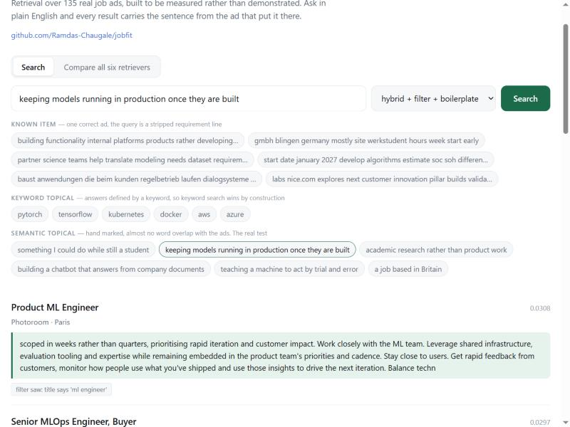
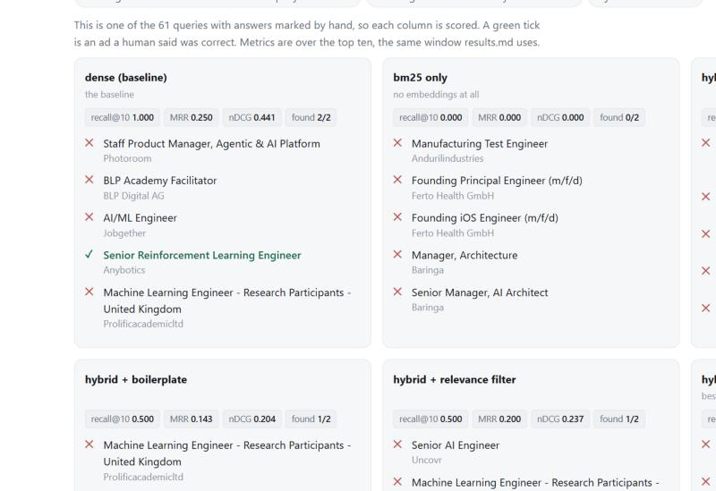
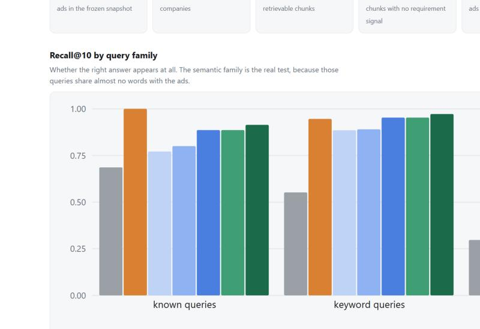
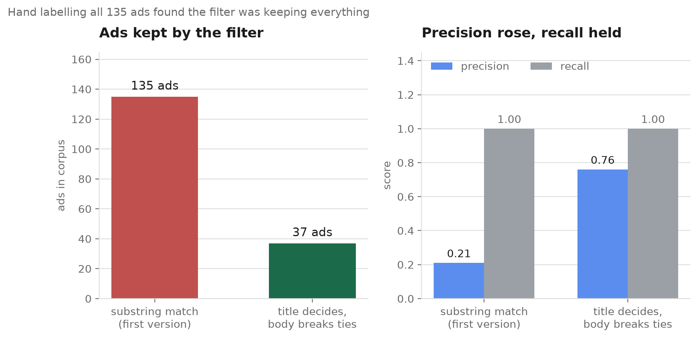
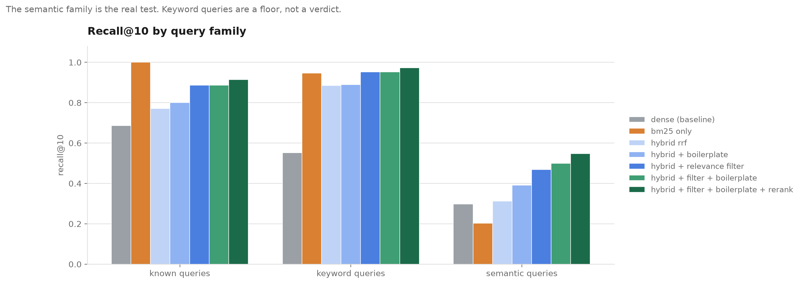
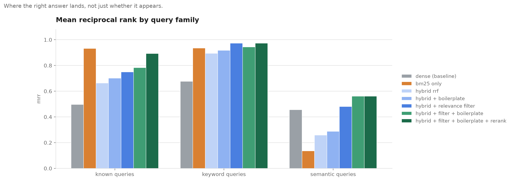

# jobfit

[](https://github.com/Ramdas-Chaugale/jobfit/actions/workflows/ci.yml)
[](https://www.python.org/)
[](tests/)
[](#where-the-data-comes-from)

Retrieval over live job ads, built to be measured rather than demonstrated.

Ask it something in plain English, get back the roles that actually match, with
the sentence from the ad that justifies each one.

```bash
pip install -r requirements.txt
python -m jobfit.corpus              # 300 live ads, no API key needed
python -m jobfit.index build         # embed and index
python -m jobfit.index search "who wants PyTorch and Kubernetes"
```

Runs on a clean clone with nothing to sign up for.

---

## Start here: the notebook

**[notebooks/01_the_journey.ipynb](notebooks/01_the_journey.ipynb)** walks the
whole project in order, with the figures and the output already in it. GitHub
renders it, so you can read it without cloning anything.

It **calls the code rather than repeating it.** Every cell imports from
`src/jobfit/` and `eval/`, the same modules the tests and CI use, so a number in
the notebook cannot disagree with a number in the repository. It is generated by
`notebooks/build_notebook.py` and executed, rather than hand edited, for the same
reason.

Build it, pipeline first, then measure it, then find out the measurement is
mostly about your own code.

---

## There is a web interface

```bash
python -m app.server      # http://127.0.0.1:8000
```



Every result carries the chunk that put it there, so "why am I being shown
this" has an answer on the page. A chunk with no requirement signal is marked
as boilerplate rather than hidden, and the badge underneath says what the
corpus filter saw in the title.

### The part worth clicking: all seven retrievers, scored



Most retrieval demos show you a ranking and leave you to take it on trust. **61
of the queries here have answers marked by hand**, so when you run one of those
the page scores every column live and marks each result right or wrong. Recall,
MRR and nDCG are computed over the top ten, the same window `results.md` uses,
so what the page says and what the repository publishes cannot drift apart.

On *"teaching a machine to act by trial and error"*, a query that shares almost
no words with any ad:

| retriever | recall@10 | MRR | found |
|---|---:|---:|---:|
| bm25 only | 0.000 | 0.000 | 0 of 2 |
| dense (baseline) | 1.000 | 0.250 | 2 of 2 |
| hybrid + filter + boilerplate | 0.500 | 0.200 | 1 of 2 |
| **+ rerank** | **1.000** | **1.000** | **2 of 2** |

BM25 finds nothing at all. The baseline finds both but buries them. The
reranker puts both at positions one and two. That is the argument for a
cross-encoder in one screen, and you can run it yourself rather than read it
here.

Type your own query and the page says plainly that there is nothing to score it
against, and shows the rankings without ticks.

### An evaluation tab, with the numbers it was built on



Corpus shape straight from the running index, then recall and MRR by family as
charts, then every number in a table. The tables are **read out of
`eval/results.md`**, not recomputed, so the page cannot show a figure the
repository does not also publish. Charts are hand-drawn SVG with no charting
library, and they take their colours from the same tokens as the rest of the
page, so they follow your light or dark theme.

---

## What the measurement found

Full numbers in [eval/results.md](eval/results.md). CI regenerates that file
and fails if it does not match, so nothing below is a number typed in by hand.

### 1. The filter was keeping almost everything

The corpus is meant to hold only AI, ML and data roles. All 135 ads in the
frozen snapshot passed the first version of that filter. Hand labelling all
135 says 28 are plainly those roles, so it was running at **21% precision**:
close to no filter at all.

Two reasons, both ordinary.

- `llm` was matched as a substring, so it fired inside **fulfillment**.
- "AI" appears in **121 of the 135 ads**. Every company selling software says
  it somewhere, so a mention of AI says almost nothing about the job.

The replacement rests on one observation: the title says what the job is, the
body says what the company does. So the title decides, and the body is only
consulted for a title like "Senior Software Engineer" that does not say.

<picture>
  <source media="(prefers-color-scheme: dark)" srcset="docs/filter-dark.png">
  
</picture>

| filter | ads kept | precision | recall |
|---|---:|---:|---:|
| substring match | 135 | 0.21 | 1.00 |
| title decides, body breaks ties | 37 | 0.76 | 1.00 |

Recall stays at 1.00, so the precision is not bought by dropping real roles.
The threshold is swept in `python -m eval.run_filter`, which also prints every
ad it disagrees with the labels about, because a number on its own does not say
whether the rule is wrong or the label is.

### 1b. The published table only reproduced on one machine

CI regenerates `eval/results.md` on every push and fails if it differs. It went
red on a commit that touched nothing it runs, which is the useful kind of red.

`np.argsort` defaults to quicksort, which is **not stable**. Every query in this
corpus has tied scores, and **21 of the 61 produced a different top 80**
depending on how ties were broken. Quicksort's tie order is a property of the
numpy build and the platform, so the table reproduced on the machine that wrote
it and not on a Linux runner.

The fix is `kind="stable"` on every ranking derived from a score. The published
numbers did not move, which is the point: they were right, they just were not
reproducible, and a reproducibility harness that only reproduces in one place is
not one.

BM25 was already safe, because Python's `sorted` is stable.

### 2. A third of the chunks say nothing about the job

**315 of 926 chunks** name no requirement and no specific technology. They are
About Us paragraphs and equal opportunity notices. For the query *"PyTorch
computer vision deep learning"* the old top result was a chunk reading *"AI is
transforming our world"*, because generic marketing prose about AI sits closer
to a generic AI query than a list of tools does.

### 3. On two families out of three, plain keyword search beats the embeddings

61 queries, three families, every retriever returning ten ads.

| variant | known recall@10 | known mrr | keyword recall@10 | keyword mrr | semantic recall@10 | semantic mrr |
|---|---:|---:|---:|---:|---:|---:|
| dense (baseline) | 0.686 | 0.496 | 0.552 | 0.676 | 0.297 | 0.456 |
| bm25 only | 1.000 | 0.932 | 0.946 | 0.935 | 0.203 | 0.135 |
| hybrid rrf | 0.771 | 0.663 | 0.885 | 0.894 | 0.312 | 0.259 |
| hybrid + boilerplate | 0.800 | 0.701 | 0.890 | 0.917 | 0.391 | 0.287 |
| hybrid + relevance filter | 0.886 | 0.749 | 0.953 | 0.972 | 0.469 | 0.481 |
| hybrid + filter + boilerplate | 0.886 | 0.783 | **0.953** | 0.944 | **0.500** | **0.560** |

<picture>
  <source media="(prefers-color-scheme: dark)" srcset="docs/recall-dark.png">
  
</picture>

<picture>
  <source media="(prefers-color-scheme: dark)" srcset="docs/mrr-dark.png">
  
</picture>

Both charts are drawn from `eval/results.md` by `python -m eval.make_charts`, so
a picture cannot quietly disagree with the table above it.

BM25 wins the keyword family by construction, since the correct answers for
that family are defined by a keyword. It also wins the known-item family
outright, which is not by construction and is worth saying plainly: for finding
one specific ad on a corpus this small, a forty line BM25 beats a transformer.

The semantic family is the one that justifies the embeddings. Its queries are
hand marked and share almost no words with the ads, so *"keeping models running
in production once they are built"* has to reach an MLOps ad that never uses
that phrase. BM25 manages 0.203 recall@10 there. The baseline manages 0.297,
and the two fixes together take it to **0.500**, with MRR from 0.456 to 0.560.

Filtering removes three ads that are correct answers, so the filtered rows sit
under a recall ceiling of 0.90, 0.96 and 0.94. Their shortfall against the
unfiltered rows on known-item recall is a missing ad, not a worse ranking, and
results.md says so next to the table.

### 4. A cross-encoder reranker, and the half of it that did not work

Retrieval scores a query against a chunk without the two ever meeting: the
chunk was embedded long before the query existed. A cross-encoder reads both
together, so it can notice that *senior* in the query and *graduate* in the ad
are the same word family pointing opposite ways. It is far too slow for 926
chunks, so it reorders the top 40 from the hybrid stage.

| metric | hybrid + filter + boilerplate | + rerank | change |
|---|---:|---:|---:|
| known recall@10 | 0.886 | 0.914 | +0.028 |
| **known MRR** | 0.783 | **0.893** | **+0.110** |
| keyword recall@10 | 0.953 | 0.972 | +0.019 |
| keyword MRR | 0.944 | 0.972 | +0.028 |
| semantic recall@10 | 0.500 | 0.547 | +0.047 |
| semantic MRR | 0.560 | 0.561 | +0.001 |

**The known-item MRR gain is the real result.** A reranker reorders rather than
retrieves, so the metric about *where* the answer lands should move more than
the one about whether it appears, and it does, by a wide margin.

**The semantic MRR did not move at all.** Recall rose by 0.047, so the
reranker is pulling more correct semantic answers into the top ten, and then
ranking them no better than before. Those are the queries with almost no word
overlap with the ads, which is where a cross-encoder was supposed to help most.
It is the one number here that went against the reason for adding it, so it
stays in the table.

**BM25 still wins known-item recall outright**, 1.000 against 0.914. Reranking
operates on a shortlist, so it can never rescue an ad the first stage did not
surface. That ceiling is the honest limit of a two-stage design.

Scores are computed once and committed to `data/rerank_scores.json`, 0.38 MB
for 61 queries, the same approach the chunk vectors use. Building the cache
took 8.7 minutes on CPU; replaying it in CI takes 0.1 seconds and needs numpy
and nothing else. Rebuild with `python -m eval.build_rerank_cache`, which is
the only step that needs torch.

---

## How the evaluation is built

Three query families, kept apart so an easy one cannot hide a failure in a hard
one. Built by `python -m eval.build_queries` and committed.

| family | n | correct answers come from | its weakness |
|---|---:|---|---|
| known_item | 35 | the ad a requirement line was taken from | generated, so only as good as the line picked |
| keyword_topical | 18 | a whole-word keyword match | favours keyword retrieval by construction |
| semantic_topical | 8 | hand marked, little word overlap | small, and the marking is one person's |

Two things that had to be fixed before these numbers meant anything:

- Known-item queries have the ad's title words stripped out. Leave them in and
  the query carries its own answer, and every retriever looks good.
- The first version took the longest line of each ad, which in a lot of these
  ads is the equal opportunity notice. That produced queries like *"qualified
  applicants receive consideration employment without regard race"*, which
  every ad matches, so the question has no answer. `is_boilerplate` now rejects
  those lines, and it is the same function retrieval uses to downweight a
  chunk.

`tests/test_eval_set.py` guards the set itself: every correct answer is an ad
that exists, no correct answer is an ad labelled a different job, no known-item
query leaks its title, and the semantic queries stay low-overlap. A query set
that quietly drifts from the corpus does not crash, it just stops being true.

---

## Where the data comes from

| Source | Key needed | Ads | What it gives |
|---|---|---|---|
| **Arbeitnow** (default) | no | ~300 fetched | Europe and remote, full descriptions |
| RemoteOK | no | ~100 | remote tech |
| Adzuna | free key | UK wide | salary bands, UK locations |

These feeds are live, so counts move between runs. Everything measured above
uses the committed snapshot in `data/eval_corpus.jsonl`, which is 135 ads
across 77 companies, median length 5,020 characters. Chunk and query vectors
are committed too, so the whole evaluation replays with numpy and nothing else.

Adzuna truncates some descriptions to a single sentence. Those are dropped
rather than embedded, because a one-line ad adds a retrievable item with
nothing retrievable in it.

---

## How it is put together

**Chunking.** A whole ad is the wrong unit: the median one covers the company
blurb, the role, the requirements and the benefits, and embedding all of it
into one vector blurs the requirements. A single sentence is also wrong, since
"Experience with Kubernetes" retrieves well and then says nothing about whose
job it is.

Ads are split on blank lines and bullet boundaries, packed to about 700
characters, with 120 characters of overlap so a requirement that straddles a
seam still appears whole somewhere. That gives 926 chunks, median 833
characters, none over 1,221.

Every chunk carries its job title into the embedding. Without that, a chunk
reading "5+ years with Spark and Airflow" belongs to no role and a query naming
a job title cannot reach it.

**Index.** Vectors are L2 normalised and the index uses inner product, so the
score is plain cosine similarity. Exact search, no approximation: at a thousand
chunks an approximate index adds failure modes and saves nothing.

**Fusion.** The hybrid rows fuse the dense and BM25 rankings with reciprocal
rank fusion rather than adding their scores, because a cosine similarity and a
BM25 score are not on the same scale and normalising them would itself need
tuning.

**Roll-up.** Several chunks of one ad often rank together. A reader wants a list
of jobs, not the same job four times, so results are grouped by ad, each taking
its best chunk's score and keeping the rest for citation.

---

## Running it

```bash
python -m eval.run_filter               # filter precision and recall, with disagreements
python -m eval.build_queries            # rebuild the query set
python -m eval.run --inspect            # the table, plus the baseline's worst failures
python -m eval.run --inspect --check    # fail if results.md would change
pytest                                  # 63 tests, no model download
```

---

## Status

Working: ingest from three sources, the relevance filter, chunking, embedding,
FAISS index, BM25, hybrid fusion, cross-encoder reranking, ad-level roll-up,
the web interface, and the evaluation above. 66 tests in CI, plus a second CI
job that replays the whole evaluation and compares it to the committed results.

Not built yet: answer generation with citations, faithfulness scoring of a
generated answer against those citations, and deployment.

Next, in order:

1. Answer generation with citations, and a faithfulness measure for it
2. Deploy it, then watch latency and retrieval quality over time
3. Work out why reranking lifts semantic recall by 0.047 and semantic MRR by
   0.001. More correct answers are reaching the top ten and none of them are
   moving up it, which should not be true of a cross-encoder and probably says
   something about the eight semantic queries rather than the model

The README carries the numbers as they arrive, including the ones that do not
flatter it.
